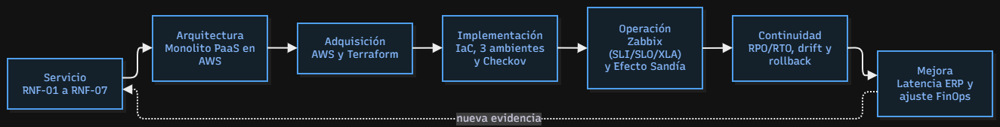

# Infraestructura como Código (IaC) — Plataforma E-Commerce Híbrida
 
Repositorio de demostración técnica (PoC) y evidencias de gestión controlada de cambios para el **Proyecto integrador: gestión del ciclo de vida de la infraestructura** (Gestión de Infraestructura — UPB). Reúne la evidencia de los Entregables 3 y 4.
 
---
 
## 1. Descripción General y Alcance (Diseño Objetivo vs. PoC)
 
Este repositorio implementa mediante **Terraform** y **GitHub Actions** el núcleo declarativo de red y cómputo elástico definido para la plataforma de comercio electrónico híbrida en **Amazon Web Services (AWS)**:
 
- **Diseño Objetivo (Producción — 5 meses):** Monolito Híbrido/BFF sobre AWS Elastic Beanstalk (`t4g.medium`, 2 a 6 instancias Multi-AZ), ALB con TLS 1.3, AWS WAF, Amazon RDS PostgreSQL Multi-AZ (`db.m6g.large`), Amazon ElastiCache for Redis (`cache.t4g.small`), Amazon S3, túnel AWS Site-to-Site VPN IPsec (AES-256) hacia el ERP *on-premises* y **observabilidad centralizada mediante Zabbix** (cobertura híbrida AWS + ERP *on-premises* y monitoreo sintético XLA para prevenir el Efecto Sandía).
- **Alcance de la Prueba de Concepto (PoC — AWS Academy `us-east-1`):** Despliegue autocontenido y reproducible de la capa de red (`VPC 10.0.0.0/16` en `us-east-1a` y `us-east-1b`), seguridad perimetral (`Security Group` con tráfico HTTP y el puerto TCP `10050` preparado para *Zabbix Agent*), plantilla de lanzamiento (`Launch Template` con Amazon Linux 2023 y Apache) y grupo de autoescalado (`Auto Scaling Group`) con instancias `t3.micro` bajo criterios FinOps.

 
*En el diagrama, el verde indica lo desplegado en la PoC y el amarillo el diseño objetivo.*
 
---
 
## 2. Estado de la Evidencia
 
| Componente | Estado |
| :--- | :--- |
| VPC Multi-AZ, Security Group, Launch Template y ASG (10 recursos) | Ejecutado en AWS Academy (`prod`) |
| Escalado de 2 a 4 instancias (RFC-2026-014) y rollback con `git revert` (16 s) | Ejecutado |
| AMI fija y *lock file* versionado (RFC-2026-015) | Ejecutado |
| Techo FinOps unificado en 6 instancias (RFC-2026-016) | Ejecutado (validado en CI) |
| Análisis estático con Checkov, modo no bloqueante (RFC-2026-017) | Ejecutado en CI |
| Regla TCP `10050` para *Zabbix Agent* en el Security Group (RFC-2026-018) | Definida en IaC y validada en CI |
| Servidor y agentes Zabbix, *Web Scenarios*, detección nocturna de *drift* | Diseño objetivo (no desplegado) |
| Estado remoto en S3 con bloqueo en DynamoDB, RDS, ElastiCache, WAF, VPN, Elastic Beanstalk y ALB | Diseño objetivo (no desplegado) |
| Restauración de RDS y simulacro de RTO | Diseño objetivo (no ejecutado) |
 
La PoC usa estado local de Terraform por las restricciones del Learner Lab.
 
---
 
## 3. Estructura del Repositorio
 
```text
ecommerce-infra-iac/
├── .github/
│   └── workflows/
│       └── iac-validation.yml      # Pipeline CI: terraform fmt, terraform validate y Checkov
├── diagrams/                       # Diagramas (.png) y fuentes editables (.drawio)
│   ├── arquitectura-objetivo-poc.drawio
│   ├── arquitectura-objetivo-poc.png
│   ├── ciclo-vida-solucion.drawio
│   ├── ciclo-vida-solucion.png
│   ├── flujo-cambio-controlado.drawio
│   └── flujo-cambio-controlado.png
├── docs/
│   └── observabilidad-zabbix.md    # Estrategia de observabilidad, SLI/SLO y señales doradas
├── environments/                   # Configuración aislada por ambiente
│   ├── dev/
│   │   └── terraform.tfvars        # Desarrollo (1 instancia t3.micro)
│   ├── qa/
│   │   └── terraform.tfvars        # QA/Staging (2 instancias t3.micro)
│   └── prod/
│       └── terraform.tfvars        # Producción (2 base, 4 en pico estacional)
├── main.tf                         # Red Multi-AZ, Security Group, Launch Template y ASG
├── variables.tf                    # Variables con validación FinOps (máx. 6 instancias)
├── outputs.tf                      # Salidas de verificación (VPC ID, ASG, capacidad)
├── .gitignore                      # Exclusión de estados locales (.tfstate)
└── README.md
```
 
---
 
## 4. Parametrización por Ambiente
 
Las diferencias de capacidad entre entornos se gestionan mediante archivos `.tfvars`, manteniendo intacto el código base:
 
| Variable (`variables.tf`) | Desarrollo (`dev`) | Pruebas (`qa`) | Producción (`prod`) | Regla de Gobernanza / FinOps |
| :--- | :---: | :---: | :---: | :--- |
| `env_name` | `"dev"` | `"qa"` | `"prod"` | Aislamiento lógico y etiquetado |
| `instance_type` | `"t3.micro"` | `"t3.micro"` | `"t3.micro"` *(PoC)* | `t4g.medium` en el diseño objetivo |
| `asg_min_instances` | `1` | `2` | `2` | Capacidad mínima garantizada |
| `asg_desired_instances` | `1` | `2` | `2` *(base)* / `4` *(pico)* | Escalado estacional controlado |
| `asg_max_instances` | `2` | `4` | `6` | Techo presupuestario: `asg_desired_instances` no puede superar 6 |
 
Desarrollo no exige alta disponibilidad, pero sus cambios siguen el mismo flujo gobernado (RFC, Pull Request e IaC) que Producción.
 
---
 
## 5. Pipeline de Validación Continua (CI)
 
Cada `push` o `Pull Request` hacia `main` dispara el flujo **Validacion IaC en AWS** (`.github/workflows/iac-validation.yml`) con dos *jobs* independientes:
 
1. **`terraform-checks`:** verifica el formato (`terraform fmt -check -recursive`), inicializa sin credenciales (`terraform init -backend=false`) y valida sintaxis y tipos (`terraform validate`).
2. **`checkov`:** ejecuta análisis estático de seguridad (*Policy as Code* con `bridgecrewio/checkov-action@v12`, `soft_fail: true`) para documentar hallazgos entre el entorno de laboratorio y el diseño objetivo.
El pipeline no tiene credenciales de AWS: no ejecuta `terraform plan` ni `apply`. Esos pasos se ejecutaron de forma local.
 
---
 
## 6. Ciclo de Vida y Trazabilidad de Cambios (ITIL 4 + Git)
 
Toda modificación sigue el flujo **RFC → Rama aislada → Pull Request → Pipeline CI → `terraform plan` → `terraform apply` → Validación → Rollback**:
 

 
*Checkov se incorporó al pipeline en RFC-2026-017 y Zabbix forma parte del diseño objetivo. En el RFC-2026-014 la validación se realizó con `terraform output` y la consola de AWS.*
 
### Historial de RFCs
 
| RFC | Rama / Commit | Descripción del Cambio | Resultado / Evidencia |
| :--- | :--- | :--- | :--- |
| **RFC-2026-001** | `main` (`378a1d7`) | Despliegue de la línea base AWS Multi-AZ (v1.0.0) con 2 instancias `t3.micro` en `prod`. | 10 recursos creados en AWS Academy. |
| **RFC-2026-014** | `chg/RFC-2026-014-escalado-temporada` (PR #1) | Cambio estándar: `asg_desired_instances` de `2` a `4` por temporada comercial. | Escalado *in-place* en 15 s; 4 nodos activos Multi-AZ. |
| **RFC-2026-014 (Revert)** | `main` (`b685319`) | Reversión controlada con `git revert` al finalizar la temporada. | Retorno a 2 nodos activos en 16 s. |
| **RFC-2026-015** | `chg/RFC-2026-015-fijar-ami-lockfile` (PR #2, `29a7f90`) | Fijación de `ami_id` en `variables.tf` para eliminar la deriva detectada en el plan. | Se evita una actualización no solicitada de la plantilla. |
| **RFC-2026-016** | `chg/RFC-2026-016-unificar-tope-instancias` (PR #3, `db653cb`) | Unificación del techo FinOps en 6 instancias, según los Entregables 1 y 2. | `terraform validate` en verde en CI. |
| **RFC-2026-017** | `chg/RFC-2026-017-agregar-checkov-pipeline` (PR #4, `63ff852`) y `docs/RFC-2026-017-documentacion-y-diagramas` (PR #5 y #6) | Análisis estático con Checkov en GitHub Actions y consolidación de README y diagramas. | Análisis SAST en cada PR; documentación en el repositorio. |
| **RFC-2026-018** | `feat/RFC-2026-018-observabilidad-zabbix` | Regla TCP `10050` en el Security Group y estrategia de observabilidad con Zabbix. | Regla definida en IaC y estrategia documentada; el servidor Zabbix no se desplegó en la PoC. |
 
---
 
## 7. Ciclo de Vida Integrado y Observabilidad
 
El ciclo de vida articula los requisitos no funcionales (`RNF-01` a `RNF-07`), las decisiones de arquitectura, la automatización declarativa y la mejora continua basada en evidencia operativa:
 

 
- **Observabilidad, SLI/SLO y XLA:** estrategia de monitoreo híbrido con **Zabbix** (AWS + ERP *on-premises*), mapeo de Señales Doradas SRE y prevención del *Efecto Sandía*, documentados en [`docs/observabilidad-zabbix.md`](docs/observabilidad-zabbix.md).
---
 
## 8. Guía Rápida de Ejecución Local
 
### Prerrequisitos
- [Terraform CLI](https://developer.hashicorp.com/terraform/downloads) `>= 1.6.0` (probado en `v1.9.0`).
- Credenciales temporales de AWS Academy Learner Lab en variables de entorno (`AWS_ACCESS_KEY_ID`, `AWS_SECRET_ACCESS_KEY`, `AWS_SESSION_TOKEN`).
### Comandos principales
 
```powershell
# 1. Inicializar proveedores y generar el archivo de bloqueo (.terraform.lock.hcl)
terraform init
 
# 2. Revisar el plan de ejecución para Producción
terraform plan -var-file="environments/prod/terraform.tfvars"
 
# 3. Aplicar la infraestructura en AWS
terraform apply -var-file="environments/prod/terraform.tfvars" -auto-approve
 
# 4. Consultar las salidas de verificación
terraform output
 
# 5. Destruir los recursos al finalizar la prueba (FinOps)
terraform destroy -var-file="environments/prod/terraform.tfvars" -auto-approve
```
 
---
 
## 9. Equipo de Trabajo
 
- **Manuela Barrera Caro**
- **Juan de Dios García López**
- **Sebastián Caicedo Araujo**