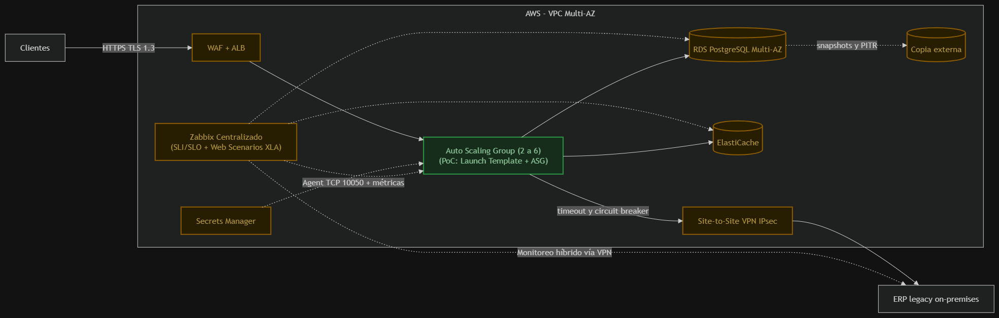
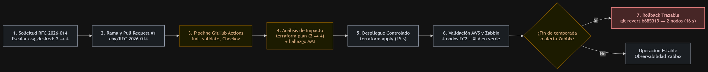

# Infraestructura como Código (IaC) — Plataforma E-Commerce Híbrida

Repositorio oficial de demostración técnica (PoC) y evidencias de gestión controlada de cambios para la **Etapa 3: Plan de Implementación y Operación** (Gestión de Infraestructura — UPB).

---

## 1. Descripción General y Alcance (Diseño Objetivo vs. PoC)

Este repositorio implementa mediante **Terraform** y **GitHub Actions** el núcleo declarativo de red y cómputo elástico definido para la plataforma de comercio electrónico híbrida en **Amazon Web Services (AWS)**:

- **Diseño Objetivo (Producción — 5 meses):** Monolito Híbrido/BFF sobre AWS Elastic Beanstalk (`t4g.medium`, 2 a 8 instancias Multi-AZ), ALB con TLS 1.3, AWS WAF, Amazon RDS PostgreSQL Multi-AZ (`db.m6g.large`), Amazon ElastiCache for Redis (`cache.t4g.small`), Amazon S3, túnel AWS Site-to-Site VPN IPsec (AES-256) hacia el ERP *on-premises* y **observabilidad centralizada mediante Zabbix** (cobertura híbrida AWS + ERP *on-premises* y monitoreo sintético XLA para prevenir el Efecto Sandía).
- **Alcance de la Prueba de Concepto (PoC — AWS Academy `us-east-1`):** Despliegue autocontenido y reproducible de la capa de red privada (`VPC 10.0.0.0/16` en `us-east-1a` y `us-east-1b`), seguridad perimetral (`Security Group` con tráfico HTTP y puerto TCP `10050` preparado para *Zabbix Agent*), plantilla de lanzamiento (`Launch Template` con Amazon Linux 2023 y Apache) y grupo de autoescalado (`Auto Scaling Group`) con instancias `t3.micro` bajo criterios FinOps.



---

## 2. Estructura del Repositorio

```text
ecommerce-infra-iac/
├── .github/
│   └── workflows/
│       └── iac-validation.yml      # Pipeline CI: terraform fmt, terraform validate y Checkov (SAST)
├── diagrams/                                       # Diagramas visuales (.png) y fuentes editables (.drawio)
│   ├── arquitectura-objetivo-poc.drawio
│   ├── arquitectura-objetivo-poc.png
│   ├── ciclo-vida-solucion.drawio
│   ├── ciclo-vida-solucion.png
│   ├── flujo-cambio-controlado.drawio
│   └── flujo-cambio-controlado.png
├── docs/                           # Documentación operativa y métricas SLI/SLO
├── environments/                   # Configuración aislada por ambiente
│   ├── dev/
│   │   └── terraform.tfvars        # Parámetros de Desarrollo (1 instancia t3.micro)
│   ├── qa/
│   │   └── terraform.tfvars        # Parámetros de QA/Staging (2 instancias t3.micro)
│   └── prod/
│       └── terraform.tfvars        # Parámetros de Producción (2 base -> 4 pico estacional)
├── main.tf                         # Definición declarativa de red Multi-AZ, SG, Launch Template y ASG
├── variables.tf                    # Variables parametrizables con validación FinOps (máx. 8 instancias)
├── outputs.tf                      # Salidas verificables post-despliegue (VPC ID, ASG, capacidad)
├── .gitignore                      # Exclusión de estados locales (.tfstate) y credenciales
└── README.md                       # Documentación principal del repositorio
```

---

## 3. Parametrización por Ambiente

Las diferencias de capacidad entre entornos se gestionan exclusivamente mediante archivos `.tfvars`, manteniendo intacto el código base declarativo:

| Variable (`variables.tf`) | Desarrollo (`dev`) | Pruebas (`qa`) | Producción (`prod`) | Regla de Gobernanza / FinOps |
| :--- | :---: | :---: | :---: | :--- |
| `env_name` | `"dev"` | `"qa"` | `"prod"` | Aislamiento lógico y etiquetado |
| `instance_type` | `"t3.micro"` | `"t3.micro"` | `"t3.micro"` *(PoC)* | `t4g.medium` en diseño objetivo |
| `asg_min_instances` | `1` | `2` | `2` | Capacidad mínima garantizada |
| `asg_desired_instances` | `1` | `2` | `2` *(Base)* / `4` *(Pico)* | Escalado estacional controlado |
| `asg_max_instances` | `2` | `4` | `6` *(PoC)* / `8` *(Objetivo)* | Techo presupuestario validado en código |

---

## 4. Pipeline de Validación Continua (CI)

Cada `push` o `Pull Request` hacia `main` dispara automáticamente el flujo **Validacion IaC en AWS** (`.github/workflows/iac-validation.yml`) con dos *jobs* independientes:

1. **`terraform-checks`:** Verifica el estándar de formato (`terraform fmt -check -recursive`), inicializa sin credenciales (`terraform init -backend=false`) y valida sintaxis y tipos (`terraform validate`).
2. **`checkov`:** Ejecuta análisis estático de seguridad (*Policy as Code* mediante `bridgecrewio/checkov-action@v12` en modo `soft_fail: true`) para auditar cumplimiento sobre los recursos Terraform y documentar hallazgos entre el entorno de laboratorio y el diseño objetivo.

---

## 5. Ciclo de Vida y Trazabilidad de Cambios (ITIL 4 + Git)

Toda modificación sigue el flujo controlado **RFC → Rama aislada → Pull Request → Pipeline CI → `terraform plan` → `terraform apply` → Validación → Rollback**:



### Historial de RFCs Ejecutados

| RFC | Rama / Commit | Descripción del Cambio | Resultado / Evidencia |
| :--- | :--- | :--- | :--- |
| **RFC-2026-001** | `main` (`378a1d7`) | Despliegue de línea base AWS Multi-AZ (v1.0.0) con 2 instancias `t3.micro` en `prod`. | 10 recursos creados en AWS Academy; CI en verde. |
| **RFC-2026-014** | `chg/RFC-2026-014-escalado-temporada` (PR #1) | Cambio Estándar: incremento de `asg_desired_instances` de `2` a `4` por temporada comercial. | Escalado *in-place* en 15 s; 4 nodos activos Multi-AZ. |
| **RFC-2026-014 (Revert)** | `main` (`b685319`) | Reversión controlada (`git revert`) al finalizar temporada comercial. | Retorno limpio a 2 nodos activos en 16 s. |
| **RFC-2026-015** | PR #2 | Fijación explícita de `ami_id` en `variables.tf` para eliminar deriva detectada en el plan. | Eliminación de actualización no solicitada de plantilla. |
| **RFC-2026-016** | `chg/RFC-2026-016-checkov-pipeline` | Integración de análisis estático de seguridad con Checkov en GitHub Actions. | Auditoría SAST automatizada en cada PR. |
| **RFC-2026-017** | `docs/RFC-2026-017-documentacion-y-diagramas` | Consolidación de `README.md`, documentación operativa y diagramas en `diagrams/`. | Trazabilidad documental completa en repositorio. |
| **RFC-2026-018** | `feat/RFC-2026-018-observabilidad-zabbix` | Incorporación de Zabbix como plataforma centralizada de monitoreo, regla TCP `10050` en SG y actualización de diagramas. | Observabilidad híbrida (AWS + ERP) y prevención de Efecto Sandía documentadas. |


---

## 6. Ciclo de Vida Integrado y Documentación Operativa

El ciclo de vida de la plataforma articula los requisitos no funcionales (`RNF-01` a `RNF-07`), las decisiones de arquitectura, la automatización declarativa y la mejora continua basada en evidencia operativa:


* **Observabilidad Centralizada y Métricas SLI/SLO/XLA:** Estrategia de monitoreo híbrido con **Zabbix** (AWS + ERP *on-premises*), mapeo de Señales Doradas SRE y prevención del *Efecto Sandía* documentados en [`docs/observabilidad-zabbix.md`](docs/observabilidad-zabbix.md).

---

## 7. Guía Rápida de Ejecución Local

### Prerrequisitos
* [Terraform CLI](https://developer.hashicorp.com/terraform/downloads) `>= 1.6.0` (probado en `v1.9.0`).
* Credenciales temporales activas de AWS Academy Learner Lab configuradas en variables de entorno (`AWS_ACCESS_KEY_ID`, `AWS_SECRET_ACCESS_KEY`, `AWS_SESSION_TOKEN`).

### Comandos Principales

```powershell
# 1. Inicializar proveedores y generar archivo de bloqueo (.terraform.lock.hcl)
terraform init

# 2. Auditar el plan de ejecución para Producción
terraform plan -var-file="environments/prod/terraform.tfvars"

# 3. Aplicar la infraestructura en AWS
terraform apply -var-file="environments/prod/terraform.tfvars" -auto-approve

# 4. Consultar salidas de verificación
terraform output

# 5. Destruir los recursos al finalizar la prueba (FinOps)
terraform destroy -var-file="environments/prod/terraform.tfvars" -auto-approve
```

---

## 8. Equipo de Trabajo

* **Manuela Barrera Caro**
* **Juan de Dios García López**
* **Sebastián Caicedo Araujo**
